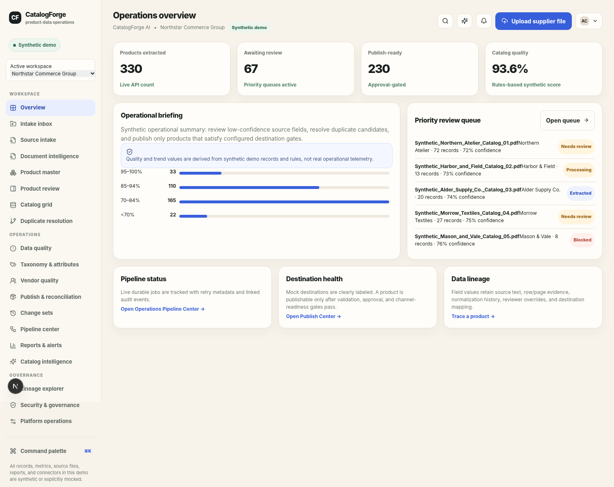
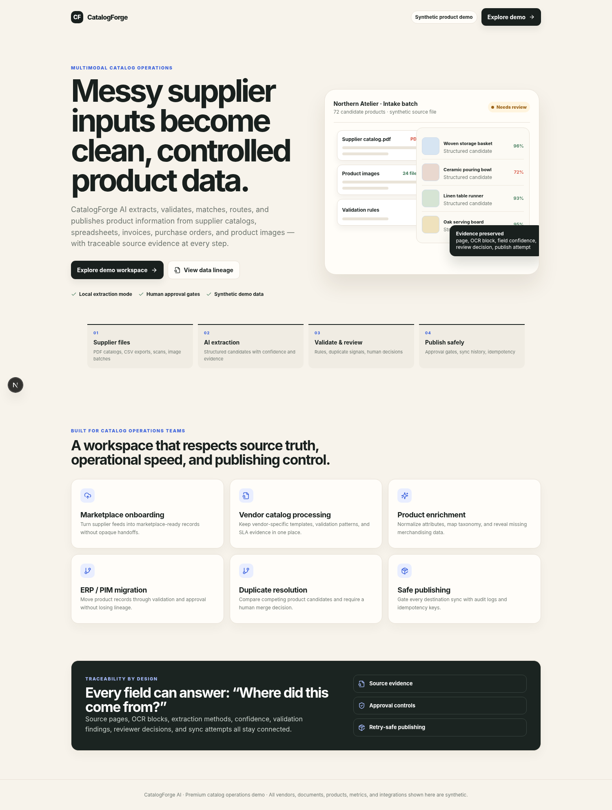
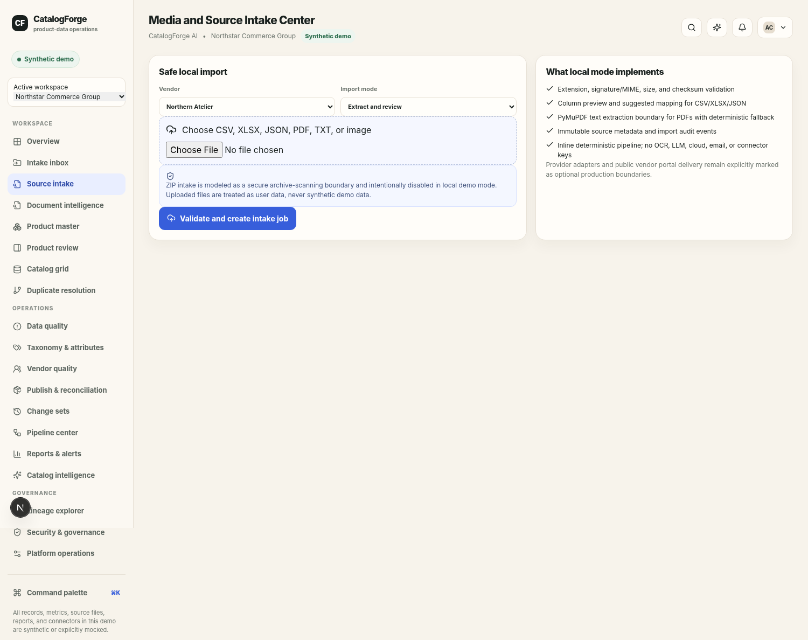
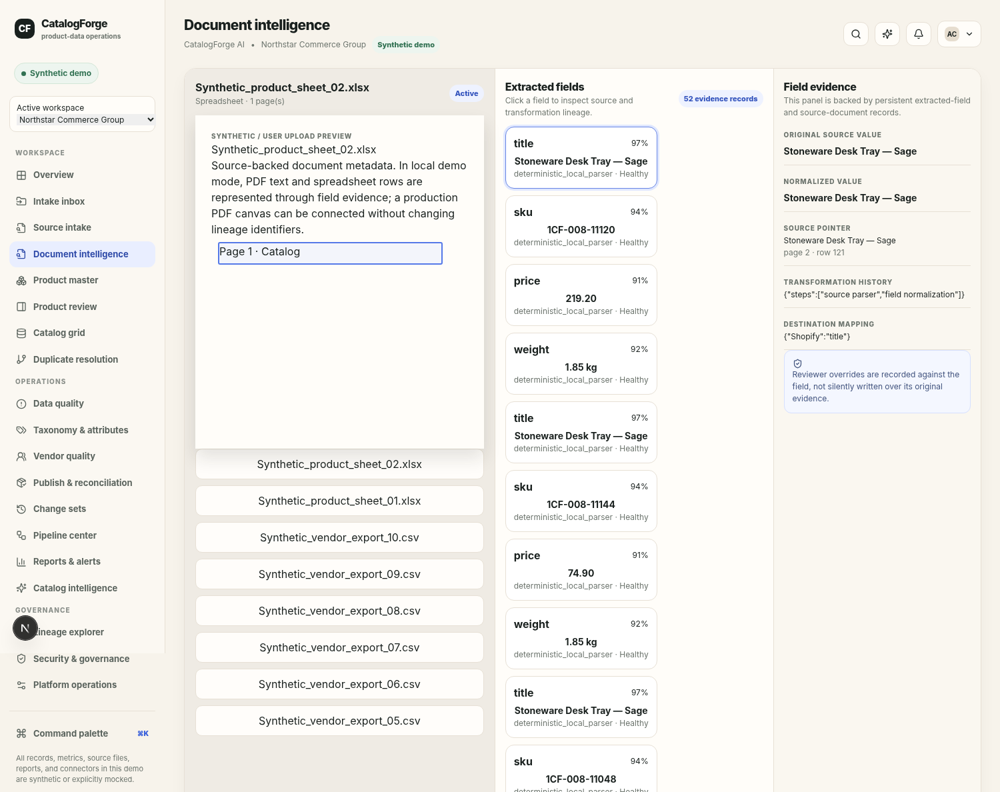
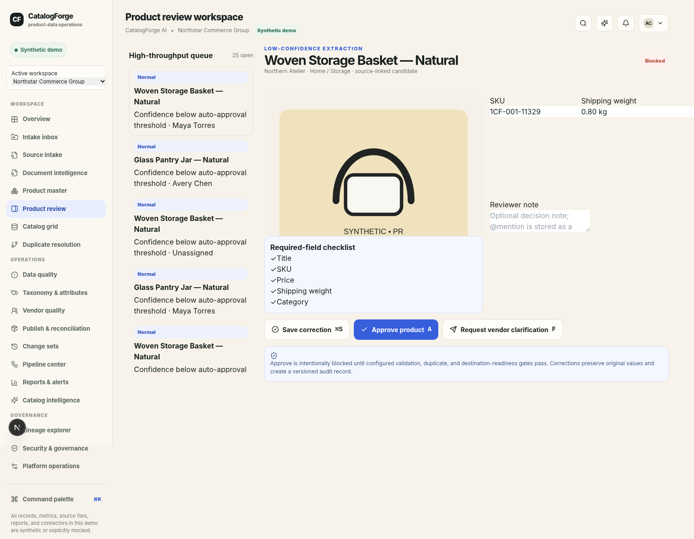
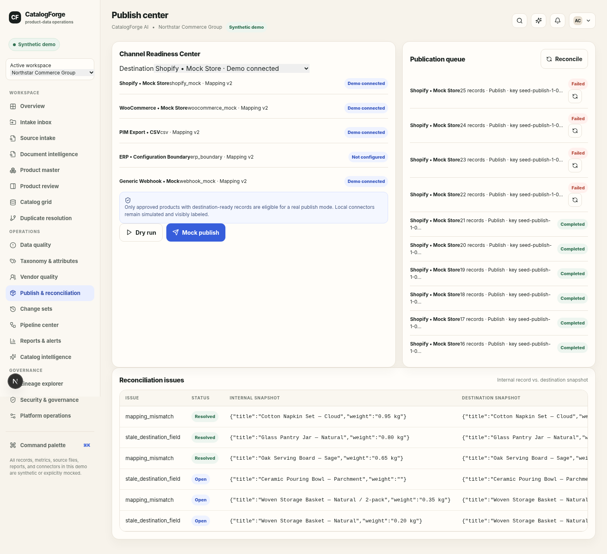
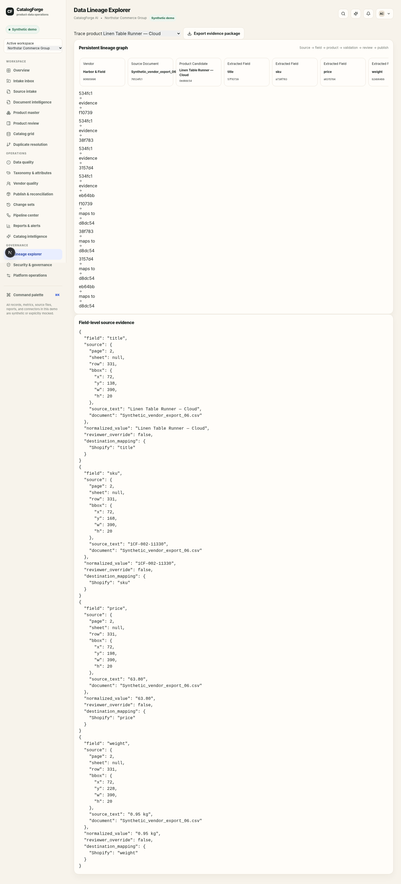
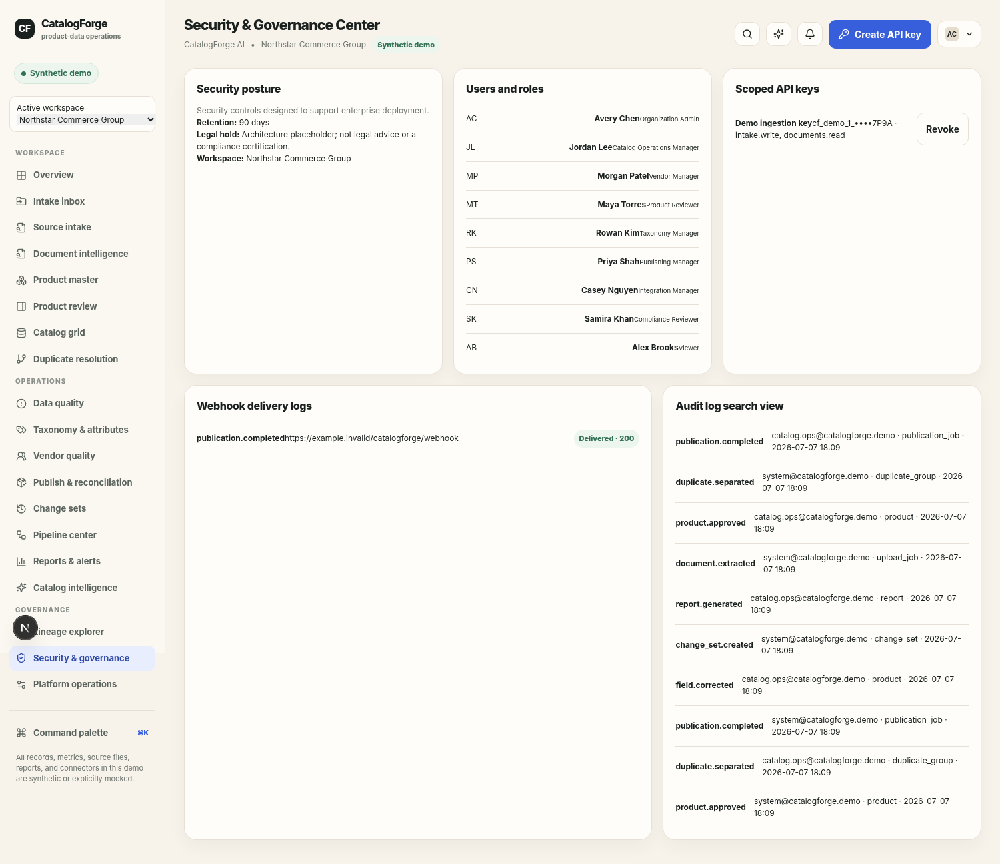

# CatalogForge AI

[](https://github.com/HUSNAIN-MUNAWAR/catalogforge-ai/actions/workflows/ci.yml)
[](LICENSE)
[](backend/pyproject.toml)
[](backend/app/main.py)
[](frontend/package.json)
[](docker-compose.yml)
[](https://github.com/HUSNAIN-MUNAWAR/catalogforge-ai)

Governed product-data operations for supplier intake, document intelligence, catalog review, launch readiness, and safe mock publishing.



CatalogForge AI is a runnable synthetic-demo monorepo for ecommerce operations teams, marketplace onboarding programs, distributors, wholesalers, retailers, and PIM or ERP migration projects. It focuses on the messy operational layer between raw supplier files and publishable product records.

Every vendor, product, source file, screenshot, report, connector response, webhook, and audit event in the seeded workspace is synthetic demo data unless a user uploads a local file. The repository does not claim real customer deployments, live connector delivery, extraction accuracy benchmarks, or compliance certification.

## Why this project exists

Supplier data rarely arrives as clean, channel-ready product records. Teams usually work across PDFs, spreadsheets, images, marketplace rules, taxonomy gaps, duplicate candidates, and manual approval queues.

CatalogForge AI exists to show a credible, end-to-end operating model for that work:

- ingest messy supplier files safely
- preserve source evidence and lineage
- normalize product candidates deterministically
- apply validation and destination readiness rules
- support human review, duplicate governance, and change approval
- simulate publish, retry, rollback, reconciliation, and audit workflows

## Core capabilities

- Multi-tenant workspace model with organization-scoped records and role-aware access.
- Safe source intake for CSV, XLSX, JSON, TXT, image metadata, and basic PDF text flows.
- Deterministic extraction pipeline with evidence, confidence, normalization, and rule evaluation.
- Product master views with completeness, quality, readiness, and version history.
- Review operations for corrections, clarifications, approvals, and audit history.
- Duplicate governance with explainable comparison factors and second-review paths.
- Vendor quality, template, and intake-link management.
- Mock publishing with dry runs, idempotency, retry, rollback, and delivery proof.
- Reconciliation, reporting, alerts, lineage, API keys, webhook logs, and redacted audit export.
- Phase 3 launch-readiness checks, saved views, and guided golden-demo endpoints.

## Architecture

```mermaid
flowchart LR
  A[Supplier files] --> B[File validation and metadata checks]
  B --> C[Document and tabular parsing boundary]
  C --> D[Deterministic extraction]
  D --> E[Normalization and taxonomy mapping]
  E --> F[Validation and completeness scoring]
  F --> G[Duplicate governance]
  G --> H[Human review and corrections]
  H --> I[Change sets and approvals]
  I --> J[Destination readiness gates]
  J --> K[Mock publish and retry]
  K --> L[Reconciliation and drift tracking]
  L --> M[Lineage, audit, and launch-readiness evidence]
```



### High-level layout

- `frontend/`: Next.js 15 application for the operator workspace and landing experience.
- `backend/`: FastAPI service, SQLAlchemy models, Alembic migrations, deterministic services, and seed data.
- `demo_data/`: synthetic source files, generated reports, and demo imagery.
- `assets/screenshots/`: real screenshots captured from the locally running application.
- `docs/`: focused implementation and operations notes for architecture, security, testing, publishing, lineage, and launch readiness.

## Screenshots

All screenshots below come from the real app using synthetic seeded data.

| Landing | Operations dashboard |
| --- | --- |
|  |  |

| Source intake | Document intelligence |
| --- | --- |
|  |  |

| Product review | Publish center |
| --- | --- |
|  |  |

| Lineage | Governance |
| --- | --- |
|  |  |

## Technology stack

- Frontend: Next.js 15, React 19, TypeScript, TanStack Query, Tailwind CSS, Playwright.
- Backend: FastAPI, SQLAlchemy 2, Alembic, Pydantic 2, PyJWT, passlib.
- Storage and data: SQLite by default in demo mode, PostgreSQL and Redis via Docker Compose topology.
- Tooling: ESLint, TypeScript, pytest, Ruff, mypy, Make, GitHub Actions.

## Demo mode and sample data

- Default local mode is deterministic and requires no third-party API keys.
- Seeded organizations, users, vendors, products, source documents, reports, and audit trails are synthetic.
- Demo passwords are intentionally shared only for local sample accounts: `DemoPass123!`.
- External connectors remain mocked unless a contributor explicitly extends the code for live systems.

### Demo accounts

| Role | Account |
| --- | --- |
| Platform or Organization Admin | `admin@catalogforge.demo` |
| Catalog Operations Manager | `catalog.ops@catalogforge.demo` |
| Vendor Manager | `vendors@catalogforge.demo` |
| Product Reviewer | `reviewer@catalogforge.demo` |
| Taxonomy Manager | `taxonomy@catalogforge.demo` |
| Publishing Manager | `publishing@catalogforge.demo` |
| Integration Manager | `integrations@catalogforge.demo` |
| Compliance Reviewer | `compliance@catalogforge.demo` |
| Viewer | `viewer@catalogforge.demo` |

Seeded workspaces:

1. Northstar Commerce Group
2. Meridian Marketplace Operations
3. Atlas Wholesale Distribution

## Quick start

### 1. Prepare environment

```bash
cp .env.example .env
```

### 2. Backend

```bash
cd backend
python -m pip install -e ".[dev]"
alembic upgrade head
python -m app.seed
python -m uvicorn app.main:app --app-dir . --reload --port 8000
```

The API will be available at `http://localhost:8000`, with OpenAPI docs at `http://localhost:8000/docs`.

### 3. Frontend

```bash
cd frontend
npm install
npm run dev
```

The app will be available at `http://localhost:3000`.

### 4. Makefile workflow

```bash
make install-api
make install-web
make migrate
make seed
make api
make web
```

## Docker workflow

```bash
docker compose up --build
```

Compose defines PostgreSQL, Redis, API, worker, and web services. Docker is optional for local deterministic mode.

## Environment variables

Copy `.env.example` to `.env` and adjust only when you need to deviate from defaults.

| Variable | Default | Purpose |
| --- | --- | --- |
| `DATABASE_URL` | `sqlite:///./catalogforge.db` | Local database for deterministic demo mode |
| `REDIS_URL` | `redis://redis:6379/0` | Worker and queue boundary for Docker-based setups |
| `JWT_SECRET` | `replace-me-in-production` | Local signing secret; replace outside demo mode |
| `STORAGE_BACKEND` | `local` | File storage backend selector |
| `LOCAL_STORAGE_PATH` | `./demo_data/source_documents` | Local source-document storage path |
| `OCR_PROVIDER` | `deterministic` | OCR provider boundary |
| `LLM_PROVIDER` | `deterministic` | Extraction provider boundary |
| `NEXT_PUBLIC_API_URL` | `http://localhost:8000/api/v1` | Frontend API base URL |

## API examples

### Health check

```bash
curl http://localhost:8000/health
```

### Login

```bash
curl -X POST http://localhost:8000/api/v1/auth/login \
  -H "content-type: application/json" \
  -d "{\"email\":\"admin@catalogforge.demo\",\"password\":\"DemoPass123!\"}"
```

### Launch readiness

```bash
curl http://localhost:8000/api/v1/launch/readiness
```

### Permission matrix

```bash
curl http://localhost:8000/api/v1/governance/permission-matrix
```

### Delivery proof

```bash
curl http://localhost:8000/api/v1/publish/jobs/<job_id>/delivery-proof
```

## CLI and developer commands

This project does not ship a standalone end-user CLI binary, but it does provide a practical developer command surface through `make`, `npm`, Alembic, pytest, and `uvicorn`.

```bash
make verify-backend
make phase3-tests
cd frontend && npm run lint
cd frontend && npm run typecheck
cd frontend && npm run build
cd frontend && npm run test:e2e
```

### Screenshot capture

If Playwright and browser binaries are available locally:

```bash
cd frontend
node scripts/capture-phase2.mjs
```

The legacy file name remains, but the script captures current Phase 3 workspace views.

## Testing, linting, type-checking, and build

### Backend

```bash
cd backend
PYTEST_DISABLE_PLUGIN_AUTOLOAD=1 pytest -q
python -m compileall -q app tests
PYTHONPATH=. DATABASE_URL=sqlite:///./phase3_migration_test.db alembic upgrade head
ruff check app tests
mypy app
```

### Frontend

```bash
cd frontend
npm install
npm run lint
npm run typecheck
npm run build
npm run test:e2e
```

See `docs/verification.md` for the latest recorded verification notes and environment-specific limitations.

## Project structure

```text
catalogforge-ai/
├── .github/
│   ├── workflows/
│   ├── ISSUE_TEMPLATE/
│   └── PULL_REQUEST_TEMPLATE.md
├── assets/screenshots/
├── backend/
│   ├── alembic/
│   ├── app/
│   └── tests/
├── demo_data/
├── docs/
├── frontend/
│   ├── app/
│   ├── components/
│   ├── e2e/
│   ├── lib/
│   └── scripts/
├── .env.example
├── docker-compose.yml
├── Makefile
└── README.md
```

## Security notes

- This repository is designed as a realistic local demo, not a compliance-certified production deployment.
- JWTs, password hashing, request IDs, scoped API keys, audit events, and role checks are implemented.
- Local secrets must never be committed; use `.env.example` as the template and keep `.env` ignored.
- Mock connectors are labeled clearly to avoid overstating live-system guarantees.
- See `SECURITY.md` and `docs/security.md` for disclosure guidance and implementation notes.

## Known limitations

- OCR and LLM extraction are optional provider boundaries; demo mode is deterministic.
- Shopify, WooCommerce, ERP, PIM, marketplace, webhook, Slack, email, and object-storage integrations are mocked or modeled unless extended by contributors.
- PDF evidence review is optimized for traceability, not full production-grade annotation UX.
- The governed assistant is restricted to workspace records and synthetic demo context.

## Contributing

Contributions are welcome. Start with `CONTRIBUTING.md` for setup, coding expectations, and PR guidance.

Helpful docs:

- `docs/architecture.md`
- `docs/testing.md`
- `docs/deployment.md`
- `docs/launch-hardening.md`
- `docs/demo-guide.md`

## Roadmap

- Add first-class live connector adapters behind explicit feature flags.
- Expand screenshot automation to cover launch-readiness and mobile-first review flows.
- Add richer export packages for lineage, audits, and release evidence.
- Harden deployment docs for managed PostgreSQL, Redis, object storage, and worker topologies.
- Introduce more scenario-driven integration tests for publish and reconciliation flows.

## License

This project is licensed under the MIT License. See `LICENSE`.

## Attribution

- Built with FastAPI, Next.js, React, SQLAlchemy, Alembic, and Playwright.
- Generated reports rely on `reportlab`.
- Spreadsheet parsing relies on `openpyxl`.
- Icons and UI primitives are implemented with `lucide-react` and project-local components.
