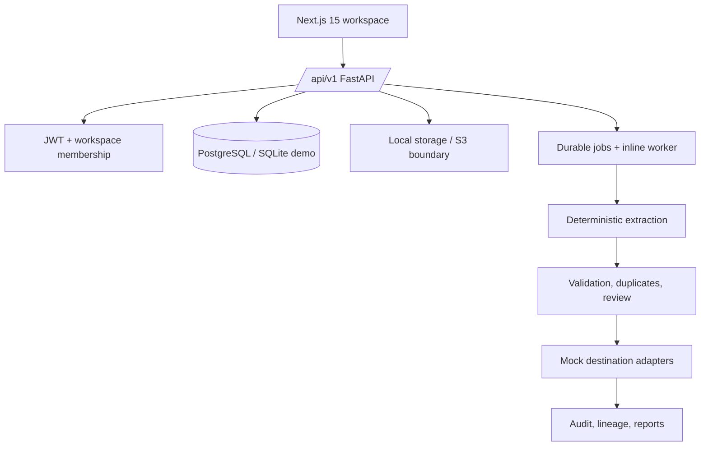
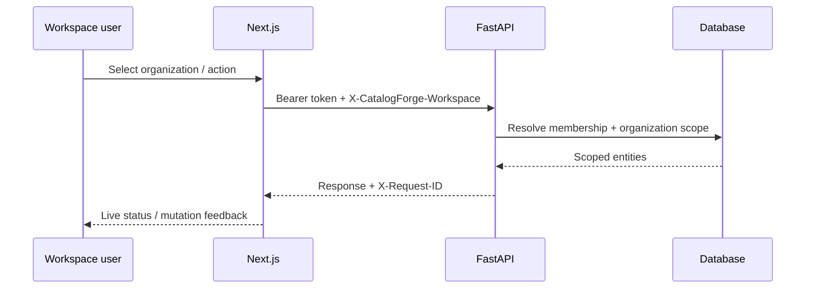

# Architecture

> **Synthetic demo disclaimer:** The workflows, vendors, documents, products, connectors, metrics, users, and outputs described here are synthetic unless a user uploads a local file. CatalogForge AI does not claim real customer data, production integrations, extraction accuracy, or compliance certification.

CatalogForge AI uses a Next.js client, a versioned FastAPI API, SQLAlchemy persistence, Alembic migrations, local demo storage, durable-job records, and adapter boundaries for OCR, LLMs, object storage, workers, and channel connectors.

The local path intentionally executes jobs inline for repeatability. A worker process exists as a deployment boundary and can later claim queued durable jobs from Redis or a queue framework. All critical resource reads are scoped by `organization_id` at the backend query layer.

## Request lifecycle

See also [multi-tenancy](multi-tenancy.md), [intake pipeline](intake-pipeline.md), and [deployment](deployment.md).
