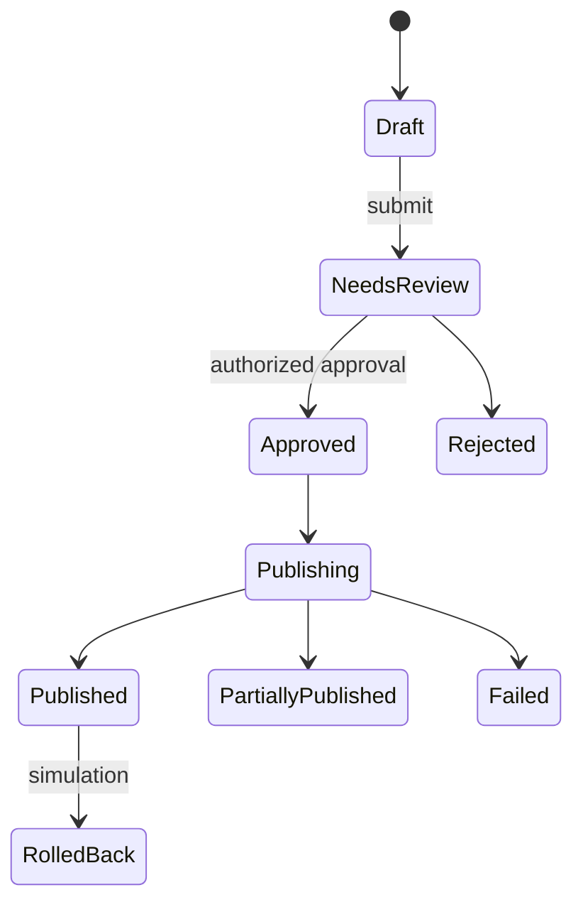

# Change sets and approval gates

> **Synthetic demo disclaimer:** The workflows, vendors, documents, products, connectors, metrics, users, and outputs described here are synthetic unless a user uploads a local file. CatalogForge AI does not claim real customer data, production integrations, extraction accuracy, or compliance certification.

A change set groups product publication intent and preserves before/after state, validation state, risk level, approval policy, approvals, and audit events. High-risk behavior can require Organization Admin review; normal publishing is restricted to appropriately scoped roles.

The demo creates publication jobs without silently bypassing product approval or destination readiness gates.
