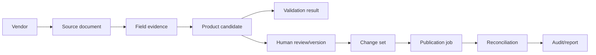

# Data lineage explorer

> **Synthetic demo disclaimer:** The workflows, vendors, documents, products, connectors, metrics, users, and outputs described here are synthetic unless a user uploads a local file. CatalogForge AI does not claim real customer data, production integrations, extraction accuracy, or compliance certification.

The lineage endpoint creates a persistent relationship view rather than a decorative fixed graph. It includes vendor, source document, field evidence, normalized values, validations, review tasks, product versions, publication jobs, and audit context.

The Evidence Package endpoint exports a synthetic JSON bundle. It is not a legal evidence or compliance certification artifact.
