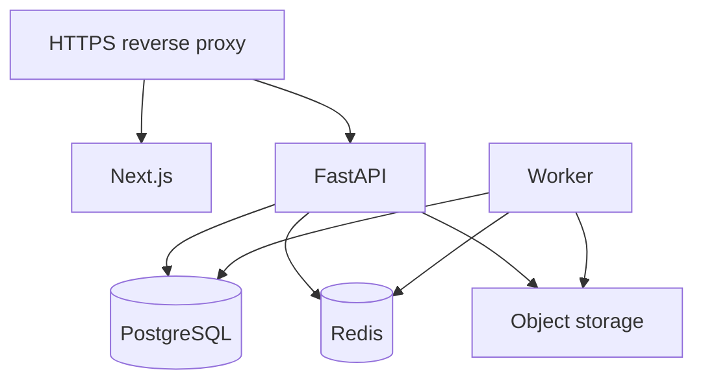

# Deployment

> **Synthetic demo disclaimer:** The workflows, vendors, documents, products, connectors, metrics, users, and outputs described here are synthetic unless a user uploads a local file. CatalogForge AI does not claim real customer data, production integrations, extraction accuracy, or compliance certification.

Docker Compose provides PostgreSQL, Redis, API, worker, and web services. For production, inject configuration via a secret manager; use PostgreSQL, an S3-compatible storage provider, proper queue worker, authenticated reverse proxy, HTTPS, CORS allowlist, automated migrations, backups, and observability.

The demo worker does not claim a production queue implementation.
