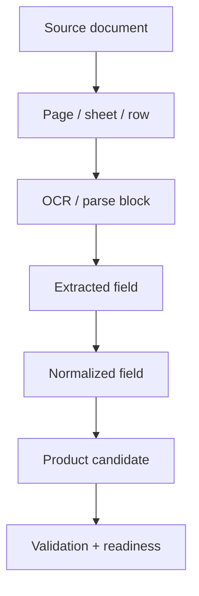

# Document intelligence

> **Synthetic demo disclaimer:** The workflows, vendors, documents, products, connectors, metrics, users, and outputs described here are synthetic unless a user uploads a local file. CatalogForge AI does not claim real customer data, production integrations, extraction accuracy, or compliance certification.

The evidence-first document workspace connects every extraction field to actual persisted source evidence. The deterministic local parser is intentionally transparent: it creates a structured candidate, confidence, extraction method, source row/page, source snippet, and synthetic bounding box where relevant.

## Extraction modes
- Deterministic CSV/XLSX/JSON row parser.
- PDF text extraction when PyMuPDF is available.
- Deterministic fallback representation for unsupported/messy documents.
- OCR, document AI, and structured LLM adapters are explicitly optional boundaries.
- Vendor templates and manual mappings can be layered before extraction.

No live OCR accuracy claim is made in demo mode.
