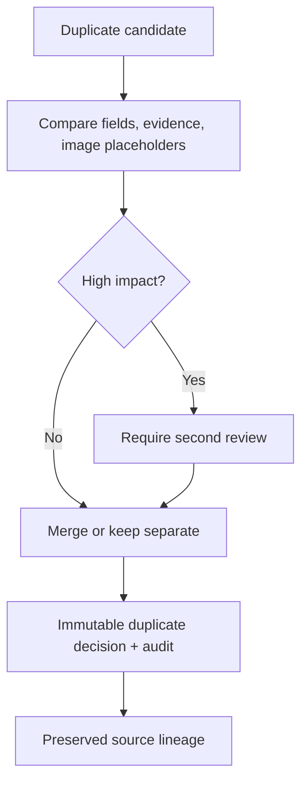

# Duplicate resolution and merge governance

> **Synthetic demo disclaimer:** The workflows, vendors, documents, products, connectors, metrics, users, and outputs described here are synthetic unless a user uploads a local file. CatalogForge AI does not claim real customer data, production integrations, extraction accuracy, or compliance certification.

Duplicate detection is explainable and human-governed. The score may incorporate normalized SKU, vendor SKU, barcode, title, brand, category, attribute overlap, price, supplier context, and image-similarity abstraction. Demo mode does not use a live image embedding service.

No duplicate is silently merged. The canonical record, selected fields, impact, rationale, and decision history remain visible.
