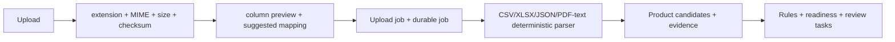

# Extraction pipeline

> **Synthetic demo disclaimer:** The workflows, vendors, documents, products, connectors, metrics, users, and outputs described here are synthetic unless a user uploads a local file. CatalogForge AI does not claim real customer data, production integrations, extraction accuracy, or compliance certification.

CatalogForge accepts safe local CSV, XLSX, JSON, PDF, TXT, and image metadata paths. The ZIP option is deliberately a disabled archive-handling boundary in demo mode.

### Safety controls
- 25 MB local demo limit.
- File extension allowlist and signature/MIME verification.
- SHA-256 checksum persisted on the source document.
- Organization-scoped vendor association and import audit event.
- A non-synthetic upload is stored separately from the seeded synthetic corpus.

Use `POST /api/v1/intake/upload`, then `/mapping-preview`, then `/process` for the live demo flow.
