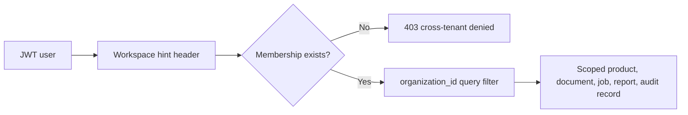

# Multi-tenancy and role boundaries

> **Synthetic demo disclaimer:** The workflows, vendors, documents, products, connectors, metrics, users, and outputs described here are synthetic unless a user uploads a local file. CatalogForge AI does not claim real customer data, production integrations, extraction accuracy, or compliance certification.

Three seeded workspaces model isolated catalog operations: Northstar Commerce Group, Meridian Marketplace Operations, and Atlas Wholesale Distribution. Every major entity stores `organization_id`; API queries resolve membership before accessing resources.

## Roles

| Role | Key permissions |
| --- | --- |
| Organization Admin | workspace, users, integrations, high-risk approvals, audit |
| Catalog Operations Manager | intake, assignment, review queues, reports |
| Vendor Manager | vendor templates, quality, intake-link simulation |
| Product Reviewer | corrections, approvals, duplicate review, notes |
| Taxonomy Manager | categories, attributes, mappings, rules |
| Publishing Manager | destination runs, retry, reconciliation |
| Integration Manager | API keys, connectors, webhooks |
| Compliance Reviewer | audit, retention, sensitive export review |
| Viewer | scoped read access |

Tenant-isolation and viewer-permission behavior are exercised in the Phase 2 backend tests.
