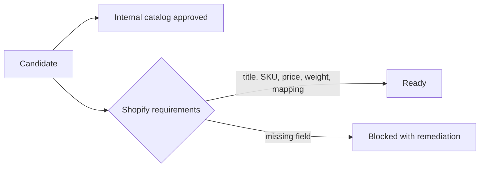

# Product master data

> **Synthetic demo disclaimer:** The workflows, vendors, documents, products, connectors, metrics, users, and outputs described here are synthetic unless a user uploads a local file. CatalogForge AI does not claim real customer data, production integrations, extraction accuracy, or compliance certification.

Phase 2 treats product candidates as governed master-data records rather than transient extraction output. The model includes title, SKU, vendor SKU, brand, category, attributes, price/cost/currency, inventory, barcode, image, dimensions, weight, quality, completeness, version history, channel readiness, and evidence.

## Completeness and channel readiness
The completeness score is a transparent rules-based score, not an AI quality claim. It checks required product fields, category, price, weight/dimensions, unresolved duplicate state, and destination requirements.

Parent/variant relationships are represented in the data model; richer variant UX is a staged extension.
