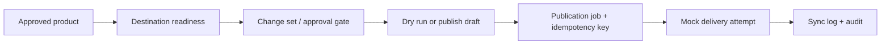

# Publishing and channel readiness

> **Synthetic demo disclaimer:** The workflows, vendors, documents, products, connectors, metrics, users, and outputs described here are synthetic unless a user uploads a local file. CatalogForge AI does not claim real customer data, production integrations, extraction accuracy, or compliance certification.

Publication destinations are organization-scoped and expose status, mapping version, required fields, retry settings/config, owner, failure count, and audit history. The Shopify connector is a local deterministic mock.

A destination success in demo mode means the mock connector returned a verified local success state; it does not indicate a real third-party sync.
