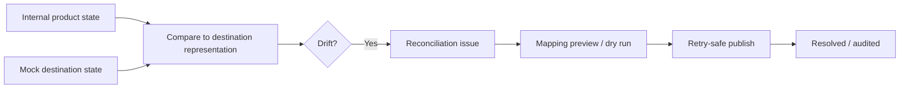

# Reconciliation

> **Synthetic demo disclaimer:** The workflows, vendors, documents, products, connectors, metrics, users, and outputs described here are synthetic unless a user uploads a local file. CatalogForge AI does not claim real customer data, production integrations, extraction accuracy, or compliance certification.

Reconciliation records capture an internal product version, a synthetic destination representation, issue type, status, resolution, and related durable job. The local reconciliation action resolves open synthetic drift records and creates an audit event.

Real destination retrieval is an integration boundary.
