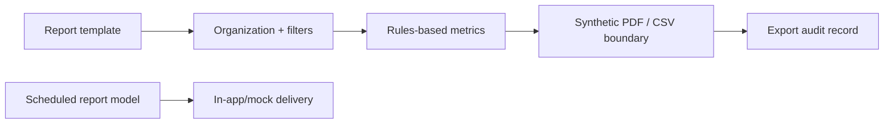

# Reporting, alerts, and watchlists

> **Synthetic demo disclaimer:** The workflows, vendors, documents, products, connectors, metrics, users, and outputs described here are synthetic unless a user uploads a local file. CatalogForge AI does not claim real customer data, production integrations, extraction accuracy, or compliance certification.

Reports are organization-scoped persistent records with type, scope, date/freshness metadata, export ID, generated-by metadata, artifact path, scheduled-report boundary, and audit event. Demo PDF exports are labeled synthetic.

Alerts provide category, severity, assignment, status, snooze/acknowledge action, and linked entity context. Email/Slack/generic webhooks remain mock delivery boundaries.
