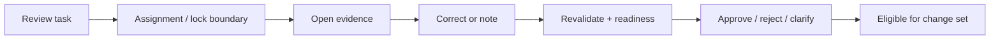

# Review operations

> **Synthetic demo disclaimer:** The workflows, vendors, documents, products, connectors, metrics, users, and outputs described here are synthetic unless a user uploads a local file. CatalogForge AI does not claim real customer data, production integrations, extraction accuracy, or compliance certification.

Review queues connect low-confidence extraction, missing fields, pricing, duplicate risk, category uncertainty, channel blocking, and vendor clarification to an explicit reviewer task. Corrections create product versions and audit events; they do not overwrite source evidence.

The workspace provides live actions for correction, approval, notes, and vendor-clarification creation. High-throughput keyboard patterns are represented in the UX, while full collaborative lock contention is a future operational enhancement.
