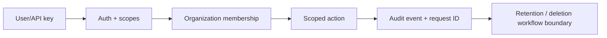

# Security and governance

> **Synthetic demo disclaimer:** The workflows, vendors, documents, products, connectors, metrics, users, and outputs described here are synthetic unless a user uploads a local file. CatalogForge AI does not claim real customer data, production integrations, extraction accuracy, or compliance certification.

Security controls are designed to support enterprise deployment. This does not represent a certification claim.

Implemented controls include password hashing, JWTs, role checks, organization-scoped queries, request IDs, basic security headers, CORS configuration, scoped/expiring/revocable API-key records, audit events, file validation, retention-request records, and redaction-aware mock webhook logs.

A real deployment should add secret management, production rotation, richer rate limiting, malware scanning, direct-object-store policies, encryption/key management, SSO, and a formal threat model.
