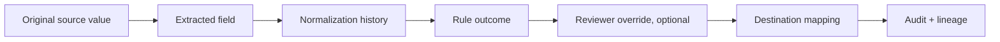

# Source-evidence governance

> **Synthetic demo disclaimer:** The workflows, vendors, documents, products, connectors, metrics, users, and outputs described here are synthetic unless a user uploads a local file. CatalogForge AI does not claim real customer data, production integrations, extraction accuracy, or compliance certification.

An `ExtractedField` preserves field name, source value, normalized value, method, confidence, source metadata, validation status, reviewer override, reviewer identity/timestamp, transformation history, and destination mapping. Original evidence is not replaced when a reviewer corrects a field.

The Document Intelligence and Product Master screens retrieve these records from `/api/v1/documents/{id}/evidence` and `/api/v1/products/{id}`.
