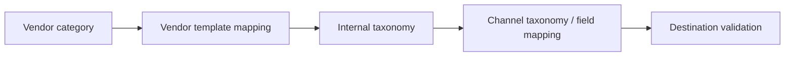

# Taxonomy and attribute governance

> **Synthetic demo disclaimer:** The workflows, vendors, documents, products, connectors, metrics, users, and outputs described here are synthetic unless a user uploads a local file. CatalogForge AI does not claim real customer data, production integrations, extraction accuracy, or compliance certification.

Taxonomy is modeled as organization-scoped categories, attribute definitions, mappings, category owner/status/version, and validation rules. Vendor mappings can be changed through an API path and the impact preview reports affected products and validation risk.

Governance fields include data type, required status, category applicability, channel applicability, allowed values, normalization/unit boundaries, and deprecation state.
