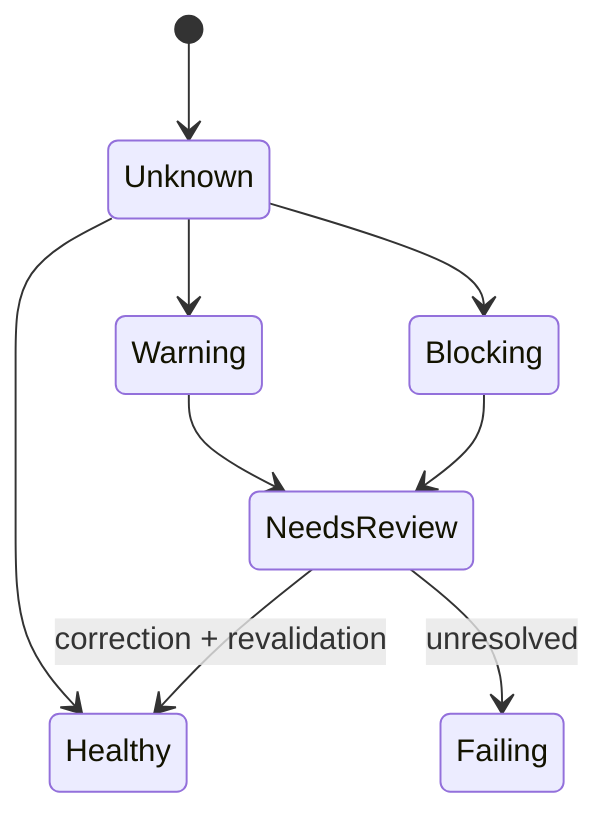

# Validation engine and Data Quality Center

> **Synthetic demo disclaimer:** The workflows, vendors, documents, products, connectors, metrics, users, and outputs described here are synthetic unless a user uploads a local file. CatalogForge AI does not claim real customer data, production integrations, extraction accuracy, or compliance certification.

The deterministic validation engine supports required-field, numeric, title, inventory, duplicate, and destination-specific checks. Rule models persist scope, severity, blocking behavior, approval state, config, and organization scope.

Rules-based metrics in the Data Quality Center include catalog quality, completeness, validation failure rate, duplicate-risk rate, destination readiness, common failures, and a caveat explaining that the data is synthetic.
