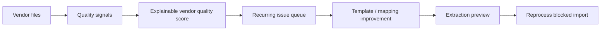

# Vendor operations and vendor quality

> **Synthetic demo disclaimer:** The workflows, vendors, documents, products, connectors, metrics, users, and outputs described here are synthetic unless a user uploads a local file. CatalogForge AI does not claim real customer data, production integrations, extraction accuracy, or compliance certification.

Vendor records carry source history, extraction confidence, validation rate, duplicate rate, source freshness, template association, SLA metadata, and an explainable operational quality score. The score is rules-based and synthetic; it is not a performance guarantee.

Vendor-specific intake links are simulated token records with expiry, allowed source types, template version, and upload audit event. They are not a public production portal.
