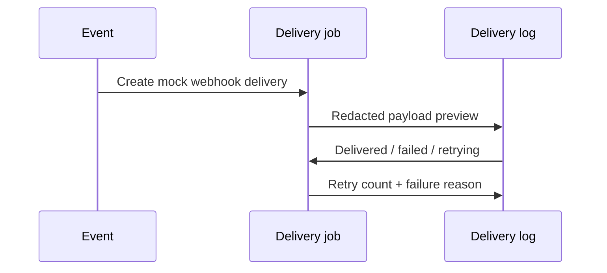

# Webhooks and developer events

> **Synthetic demo disclaimer:** The workflows, vendors, documents, products, connectors, metrics, users, and outputs described here are synthetic unless a user uploads a local file. CatalogForge AI does not claim real customer data, production integrations, extraction accuracy, or compliance certification.

The data model and mock delivery log support `intake.received`, `intake.validated`, `extraction.completed`, `extraction.failed`, `review.task_created`, `product.approved`, `product.rejected`, `duplicate.confirmed`, `duplicate.merged`, `publish.started`, `publish.completed`, `publish.failed`, `reconciliation.detected`, `vendor.quality_changed`, `report.generated`, and `alert.created`.

No external delivery target is called by the demo.
